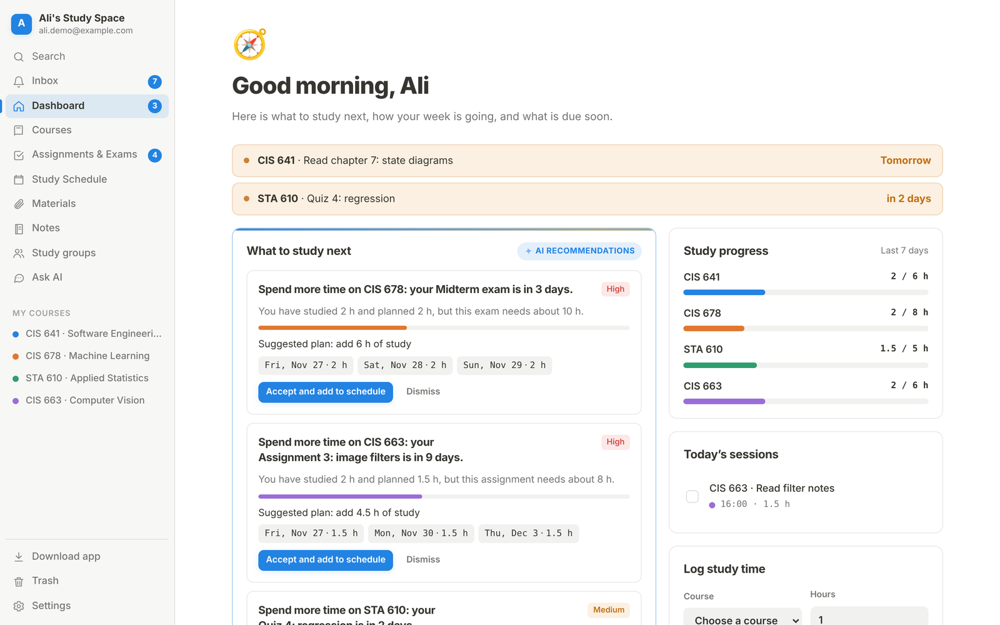
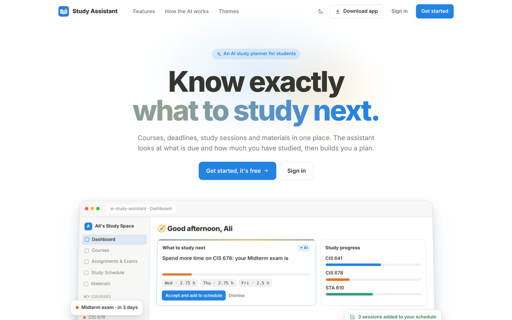
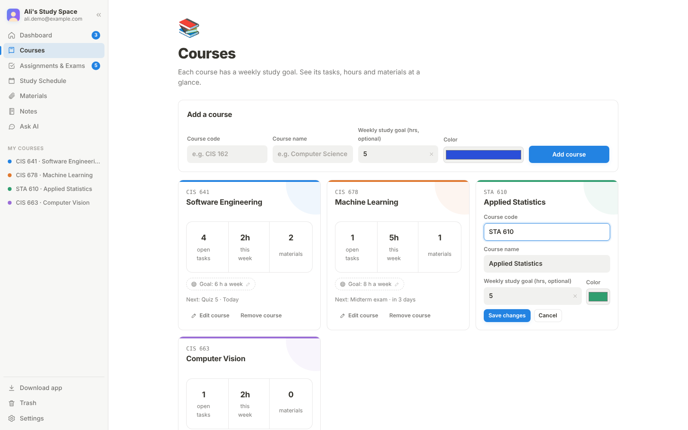
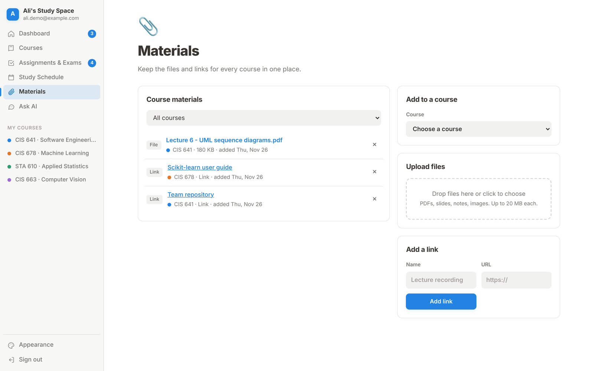
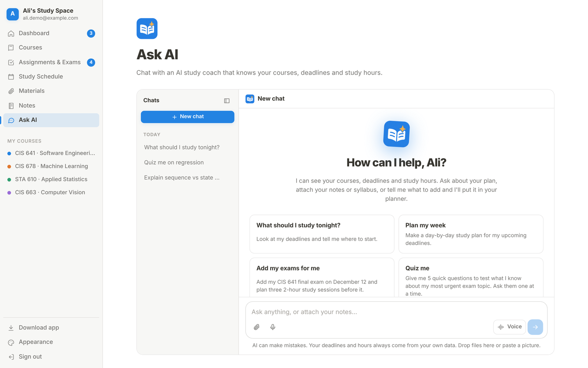
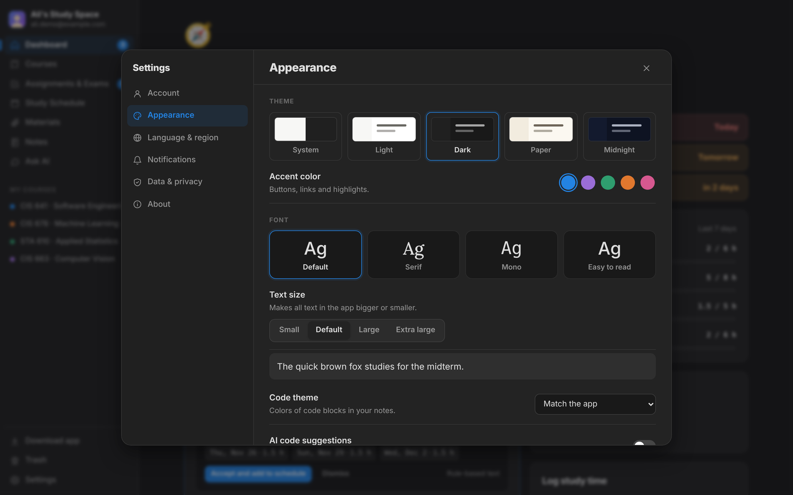
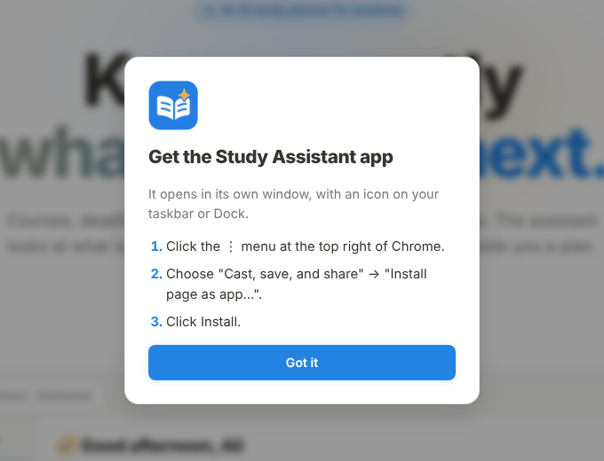

<p align="center">
  
</p>

<h1 align="center">AI Study Assistant</h1>

<p align="center">
  A study planner for university students: courses, deadlines, study hours and an AI study coach, all in one place.<br />
  <a href="https://gvsu-cis641-aistudyassistant.onrender.com"><b>Open the live app</b></a>
  ·
  <a href="#how-to-use-the-app">How to use it</a>
  ·
  <a href="src/README.md">Developer guide</a>
  ·
  <a href="docs/software_requirements_specification.md">Requirements</a>
</p>

<p align="center">
  
</p>

---

The AI Study Assistant is a web application that helps students organize their school work in one place. Students manage their courses, assignments, exams, study schedule and course materials, and track how many hours they study for each course. The app works out where the student is behind, recommends what to study next with a concrete plan of study sessions, and includes an AI chat coach that knows the student's own deadlines and hours and can add things to the planner for them.

Built for **CIS 641 (Software Engineering)** at Grand Valley State University.

> The live app runs on a free server that sleeps when unused. The first visit can take about a minute to wake up.

## Features

| Area | What the student can do |
|---|---|
| **Dashboard** | See what to study next, hours studied this week against each course's goal, today's sessions and what is due soon |
| **Courses** | Add courses with a weekly study-hour goal and a color |
| **Assignments & Exams** | Add tasks with a type, due date, priority and the hours they need; tick them off when done |
| **Study Schedule** | Plan study sessions on a weekly calendar and tick them off; deadlines show in red |
| **Materials** | Upload files (PDFs, slides, notes, up to 20 MB) or save links for each course |
| **AI recommendations** | Advice on what to study next, with a session plan the student can **accept** (added to the schedule) or **dismiss** |
| **Ask AI** | Chat with an AI study coach that sees the student's courses, deadlines and hours. It explains, plans and quizzes, and it can **add courses, exams, assignments and study sessions** for the student, each with an **Undo** button |
| **Files, pictures and voice** | Attach PDFs, notes, code or screenshots to a question; dictate with the microphone; or use **Voice mode** to talk and hear the answers |
| **Chat history** | Every conversation is saved; go back to any of them or delete them |
| **Accounts** | Sign up, sign in, and reset a forgotten password through an emailed link (valid for 30 minutes, works once) |
| **Themes** | Light, Dark, Paper, Midnight or System theme, plus five accent colors |
| **Download the app** | A **Download app** button installs it on a laptop or phone in one click (Chrome and Edge), or shows the steps for other browsers. The installed app opens full screen in its own window, with an icon on the taskbar, Dock or home screen |

## How to use the app

The screenshots below use sample data.

### 1. Create your account

Open the [live app](https://gvsu-cis641-aistudyassistant.onrender.com) and click **Get started**. Enter your name, email and a password of at least 8 characters, then click **Create account**.

<p align="center">
  
  
</p>

Forgot your password? On the sign-in page, click **Forgot password?**, type your email, and open the link in the email you receive to choose a new password.

### 2. Add your courses

Go to **Courses**. Fill in the **Course code** (for example `CIS 641`), the **Course name**, your **Weekly study goal (hrs)** and a **Color**, then click **Add course**. Each course card shows its open tasks, the hours you studied this week and its materials.

<p align="center"></p>

### 3. Add your assignments and exams

Go to **Assignments & Exams**. Give each task a **Title**, pick the **Course** and **Type** (Assignment, Exam, Quiz, Project or Reading), set the **Due date**, the **Priority** and the **Study hours needed**, then click **Add**. Tick the box when a task is done. Use the filters to see one course or finished work.

<p align="center"></p>

> **Tip:** "Study hours needed" is what the assistant plans around, so give an honest estimate.

### 4. Follow the plan on the Dashboard

The **Dashboard** shows:

- **What to study next**: the tasks where you are furthest behind, with a suggested plan of study sessions before the deadline. Click **Accept and add to schedule** to put those sessions in your calendar, or **Dismiss** to hide the advice.
- **Study progress**: hours studied in the last 7 days compared with each course's weekly goal.
- **Today's sessions**: tick them off when you finish.
- **Log study time**: record studying you did outside a planned session.

See the screenshot at the top of this page.

### 5. Plan your week

Go to **Study Schedule**. Add a session with a **Course**, **Date**, **Start** time, **Hours** and a **Focus**, then click **Add session**. The week view shows your sessions, and deadlines appear as red boxes. Tick a session when you finish it, and its hours count toward your progress. Use **Previous**, **This week** and **Next** to move between weeks.

<p align="center"></p>

### 6. Keep your materials together

Go to **Materials**. Choose a course under **Add to a course**, then drop files into **Upload files** or save a web address with **Add a link**. Click a file to download it.

<p align="center"></p>

### 7. Ask the AI

Go to **Ask AI**. Ask anything about your studies, or click one of the suggestions.

<p align="center"></p>

**Let it do the work.** Tell it what to add, for example:

> Add my CIS 641 final exam on December 12 and plan three 2-hour study sessions before it.

Each change appears as a card. Click **View** to open the page, or **Undo** to take the change back. The AI can add courses, assignments, exams and study sessions, log study time, and change or finish tasks. It cannot delete anything.

<p align="center"></p>

More things you can do in the chat:

| Button | What it does |
|---|---|
| 📎 **Attach** (or drag and drop, or paste with Ctrl+V) | Add a PDF, notes, code or a picture to your question, for example *"Add all the exams from this syllabus"* |
| 🎤 **Dictate** | Speak instead of typing (Chrome and Edge) |
| **Voice** | A hands-free conversation: you talk, the assistant answers out loud, then listens again |
| **Copy**, **Read aloud**, **Retry** | Under each answer |
| ✏️ **Edit**, ↻ **Send again** | On your own messages |
| ■ **Stop** | Stops an answer that is being written |
| **Chats** panel | Every conversation is saved. Click one to go back to it, or the 🗑 icon to delete it. **New chat** starts a fresh one |

### 8. Choose your look

Click **Appearance** at the bottom of the sidebar to pick a theme (System, Light, Dark, Paper or Midnight) and an accent color.

<p align="center"></p>

### 9. Download the app to your laptop or phone

Click **Download app** at the top of the welcome page, or in the sidebar once you are signed in.

- **Chrome or Edge** (Windows, Mac, Chromebook, Android): the browser's **Install** window opens. Click **Install** and the app gets its own window and an icon in the Start menu, taskbar or Dock.
- **Other browsers:** a short guide shows the steps for your browser:
  - **iPhone (Safari):** tap **Share**, then **Add to Home Screen**.
  - **Mac (Safari):** click **File**, then **Add to Dock**.
  - **Firefox:** open the site in Chrome or Edge instead.

<p align="center">
  
</p>

The installed app fills the whole screen on phones, follows your theme, and updates by itself every time a new version is deployed.

<p align="center"></p>

**App stores (in progress):** Android (Google Play) and Windows (Microsoft Store) packages have been built with [PWABuilder](https://www.pwabuilder.com) from this same web app. An iPhone App Store version needs a Mac to build.

## How the AI works

The AI recommendations are designed so that the language model **can never invent hours or dates**:

1. **Rules find the study gap** for every open task due in the next 14 days:
   `gap = hours needed − hours studied − hours planned`
2. **Rules rank the tasks and build the plan:** score = gap × priority × task type × urgency. The top three get a plan of study sessions of up to 2 hours each, placed before the deadline.
3. **A language model writes the message** from those numbers only. If the model is off, slow or gives an invalid answer, the app uses rule-based text instead.
4. **The student decides:** accepting adds the sessions to the schedule; dismissing hides the advice.

The **Ask AI** chat sends the model a short summary of the student's own data (courses, open tasks, the computed study gaps and planned sessions) with each question, plus a guide to the app's pages. When the student asks it to add or change something, the model asks the server to run a **tool** (add a course, add a task, plan a session, log time, update a task). The server checks every value, finds the course or task by name, saves the change for that student only, and returns the result to the model. Nothing can be deleted this way, and every change can be undone.

Any OpenAI-compatible model works: [Groq](https://console.groq.com) (free, used online), OpenAI, or a local model through [Ollama](https://ollama.com). Without a model, the app still works and uses rule-based text; only the chat is turned off.

## Tech stack

| Part | Technology |
|---|---|
| Front end | React 18, Vite, React Router, plain CSS (no UI library), PDF.js for reading attached PDFs |
| Back end | Node.js 22, Express 5, JSON Web Token login, bcrypt password hashing, Multer file uploads |
| Database | MongoDB (MongoDB Atlas online), Mongoose |
| AI | Any OpenAI-compatible chat API with tool calling (Groq online); a vision model for pictures |
| Voice | The browser's Web Speech API (speech to text and text to speech) |
| Email | Brevo email API (password reset emails) |
| Hosting | Render (one web service serves the API and the built React app) |
| Phone and desktop app | Installable web app (web app manifest, service worker, one-click install button); Android and Windows store packages made with PWABuilder |
| Local deployment | Docker Compose (MongoDB, API, and nginx serving the app) |

## Team Members and Roles

* [Ali Belhrak](https://github.com/alibelhrak/CIS641-HW2-Belhrak) (Project Manager, Analyst, Designer, Developer)

## Prerequisites

* [Git](https://git-scm.com/)
* **Either** [Docker Desktop](https://www.docker.com/products/docker-desktop/) (simplest: runs everything with one command)
* **Or** [Node.js 22](https://nodejs.org/) and a MongoDB database (a free [MongoDB Atlas](https://www.mongodb.com/atlas) cluster or a local MongoDB)
* Optional: a free [Groq](https://console.groq.com) API key (or [Ollama](https://ollama.com)) for the AI text and the chat
* Optional: a free [Brevo](https://www.brevo.com) account to send password reset emails

## Run Instructions

### Option 1: Docker (one command)

```
git clone https://github.com/alibelhrak/GVSU-CIS641-AIStudyAssistant.git
cd GVSU-CIS641-AIStudyAssistant/src
copy .env.example .env        (macOS/Linux: cp .env.example .env)
docker compose up -d --build
```

Open http://localhost:8080, create an account, add a course, then add an exam with the study hours it needs. The Dashboard shows the recommendation.

### Option 2: Node.js (for development)

1. Create `src/server/.env` with at least:
   ```
   MONGO_URI=your MongoDB connection string
   JWT_SECRET=any long random text
   ```
   To turn on Ask AI, also add:
   ```
   LLM_BASE_URL=https://api.groq.com/openai/v1
   LLM_API_KEY=your Groq key
   LLM_MODEL=llama-3.3-70b-versatile
   CHAT_MODEL=openai/gpt-oss-120b
   VISION_MODEL=qwen/qwen3.8-27b
   ```
2. Start the API (port 5000):
   ```
   cd src/server
   npm install
   npm run dev
   ```
3. In a second terminal, start the web app (port 5173):
   ```
   cd src/client
   npm install
   npm run dev
   ```
4. Open http://localhost:5173.

All settings (AI, email and others) are listed in the [developer guide](src/README.md#settings).

### Run the tests

```
cd src/server
npm test
```

## Project Documents and Artifacts

* [Project Proposal](docs/proposal-template.md) ([PDF version](docs/project_proposal.pdf))
* [Software Requirements Specification](docs/software_requirements_specification.md)
* [Midterm Presentation](docs/AI_Study_Assistant_Midterm.pptx)
* [UML Class Diagram](artifacts/class_diagram.md)
* [CRC Cards](artifacts/crc_cards.md)
* [Sequence Diagram](artifacts/sequence_diagram.md)
* [State Machine Diagram](artifacts/state_machine_diagram.md)
* [Developer Guide](src/README.md): settings, API routes, deployment and project structure
