<p align="center">
  
</p>

<h1 align="center">AI Study Assistant</h1>

<p align="center">
  A study planner for university students: courses, deadlines, study hours and an AI study coach, all in one place.<br />
  <a href="https://gvsu-cis641-aistudyassistant.onrender.com"><b>Open the live app</b></a>
  ·
  <a href="#how-to-use-the-app">How to use it</a>
  ·
  <a href="#7-write-your-notes">Notes</a>
  ·
  <a href="src/README.md">Developer guide</a>
  ·
  <a href="docs/software_requirements_specification.md">Requirements</a>
</p>

<p align="center">
  
</p>

---

The AI Study Assistant is a web application that helps students organize their school work in one place. Students manage their courses, assignments, exams, study schedule and course materials, write Notion-style notes, and track how many hours they study for each course. The app works out where the student is behind, recommends what to study next with a concrete plan of study sessions, and includes an AI chat coach that knows the student's own deadlines, hours and notes and can add things to the planner for them. The same AI also works inside the notes, where it writes, explains, summarizes and quizzes.

Built for **CIS 641 (Software Engineering)** at Grand Valley State University.

> The live app runs on a free server that sleeps when unused. The first visit can take about a minute to wake up.

## Features

| Area | What the student can do |
|---|---|
| **Dashboard** | See what to study next, hours studied this week against each course's goal, today's sessions and what is due soon |
| **Courses** | Add courses with a color and an optional weekly study-hour goal; **Edit course** changes the code, name, goal and color |
| **Assignments & Exams** | Add tasks with a type, due date, priority and the hours they need; tick them off when done |
| **Study Schedule** | Plan study sessions on a weekly calendar and tick them off; deadlines show in red |
| **Materials** | Upload files (PDFs, slides, notes, up to 20 MB) or save links for each course |
| **Notes** | Notion-style pages with sub-pages, emoji icons, covers (gradients or your own picture), favorites, course tags and search. The list groups pages **by course** and into **your own folders**. Each page can use small, default or large text and full width. Type **/** for headings, lists, to-dos, tables, code, quotes and pictures. Saves while you type |
| **Code in notes** | Code blocks for about 45 languages with 16 color themes, VS Code shortcuts and AI completions. **Run** Python, JavaScript, SQL and HTML right in the page; the output appears below the code (it runs in your browser, never on the server) |
| **AI in your notes** | Select text or press **Ctrl+J** to have AI improve, shorten, explain, translate or turn it into a table; or type **/** for Continue writing, Summarize, Key takeaways, Practice quiz and Flashcards. Every answer is a preview first: **Replace**, **Insert**, **Try again** or **Discard** |
| **Notes AI chat** | An **Ask AI** panel next to every page, like Notion AI: ask about the page, attach files or pictures, or ask it to fix, rewrite or add to the page. Each change is listed as a step, highlighted in the page, and can be undone in one click. Answers have Copy, Add to page, 👍 / 👎 and Undo |
| **AI recommendations** | Advice on what to study next, with a session plan the student can **accept** (added to the schedule) or **dismiss** |
| **Ask AI** | Chat with an AI study coach that sees the student's courses, deadlines, hours and notes. It explains, plans and quizzes, and it can **add courses, exams, assignments and study sessions**, and **search, read and write notes**, each change with an **Undo** button |
| **Files, pictures and voice** | Attach PDFs, notes, code or screenshots to a question; dictate with the microphone; or use **Voice mode** to talk and hear the answers |
| **Chat history** | Every conversation is saved; go back to any of them or delete them |
| **Trash** | Anything you delete (courses, tasks, sessions, files, pages, chats) waits in the Trash for 30 days. **Undo** right after deleting, or **Restore** it later |
| **Reminders** | Turn on a morning summary of your top priorities, deadline alerts, study-session alerts and a Sunday progress email, sent by **email** and as **push notifications** on your phone or computer |
| **Accounts** | Sign up with a 6-digit code sent to your email (so nobody can use someone else's address), sign in, reset a forgotten password through an emailed link (valid for 30 minutes, works once), and delete the account with all its data from the [privacy page](https://gvsu-cis641-aistudyassistant.onrender.com/privacy) |
| **Languages** | Use the whole app in **English, Français, Español, العربية (right to left), 中文 or हिन्दी**. The AI answers, the advice on what to study, the reminder emails and the password emails follow your language |
| **Settings** | A Notion-style Settings window (sidebar, or `Ctrl+,`): edit your name, change email (with a code) and password, sign out of other devices, delete the account; profile picture; theme, accent, font (Default, Serif, Mono, Easy to read), text size and reduce motion; language, time zone, first day of the week and start page; export all your data. Preferences follow you to every device |
| **Themes** | Light, Dark, Paper, Midnight or System theme, plus five accent colors. Drag the edges of the sidebar, the notes list, the Notes AI panel and the chat list to resize them. Small animations throughout (respecting "reduce motion"), and thin scrollbars in the theme's colors |
| **Download the app** | A **Download app** button installs it on a laptop or phone in one click (Chrome and Edge), or shows the steps for other browsers. The installed app opens full screen in its own window, with an icon on the taskbar, Dock or home screen |

## What's new

- **Trash, folders, profile picture (November 2026):** deleting a course, task, study session, file, page or Ask AI chat moves it to the **Trash** (bottom of the sidebar) with an **Undo** button; restore it any time in the next 30 days, after which it is deleted for good. A course goes to the Trash together with its tasks, sessions and files. In Notes, the list groups pages **by course** and into **your own folders** (drag a page onto a folder, or use its folder button). Each page has a **text size** (small, default, large) and **full width** option (the *T* button). Drag the edge of the **sidebar**, the **notes list**, the **Notes AI panel** or the **Ask AI chat list** to make it wider or narrower (double-click resets). Add a **profile picture** in Settings › Account. A course's **weekly study goal is now optional**: leave it empty or choose *None*. **Edit course** on a course card changes its code, name, goal and color.
- **Run code in Notes (November 2026):** code blocks in **Python, JavaScript, SQL and HTML** get a **Run** button (or press `Ctrl+Enter` / `⌘+Enter`). What the program prints appears in an *Output* block right below; running again replaces it. Everything runs in your own browser, not on the server: Python is real CPython (Pyodide, downloaded once on the first run, about 10 MB, and `numpy`, `pandas` ... load when you import them), SQL is SQLite (each run starts with an empty database, so create your tables in the same block), and HTML opens in a safe preview window. A run is stopped after 10–20 seconds, so an endless loop can't freeze the page. Java, C++ and other compiled languages can't run in the browser yet.
- **Code like in VS Code (November 2026):** code blocks in Notes get VS Code shortcuts (Tab / Shift+Tab, `Ctrl+/` comment, `Alt+↑/↓` move lines, `Shift+Alt+↑/↓` copy lines, `Ctrl+Shift+K` delete line, auto-indent, auto-closing brackets) and **AI suggestions** in grey while you type: `Tab` accepts, `Ctrl+→` takes one word, `Esc` hides. Turn suggestions off in Settings › Appearance. The full list is in Settings › About.
- **Code blocks in Notes (November 2026):** type ``` or pick *Code* in the / menu. Choose from about 45 languages (Python, Java, C++, SQL, JavaScript ...), get syntax highlighting, and copy the code with one click. Pick a code theme (GitHub, Dracula, Monokai, One Dark Pro, Tokyo Night, Nord, Catppuccin, Solarized and more) from the 🎨 button on a code block or in **Settings › Appearance**. Code written by the AI is highlighted too.
- **Hide the sidebar (November 2026):** click « at the top of the sidebar or press `Ctrl+\` for more room; touch the left edge to peek at it, or click the button in the corner to bring it back.
- **Settings (November 2026):** one window for your account, appearance, language and region, notifications and your data, with fonts, text size, reduce motion, data export, password and email changes, and "sign out of other devices".
- **Languages (November 2026):** the app now works in English, French, Spanish, Arabic, Chinese and Hindi. Pick one with the 🌐 menu on the welcome page and the sign-in page, or in **Settings › Language & region**. Your choice is saved to your account.
- **Notes (November 2026):** a Notion-style notes space with sub-pages, covers (including your own pictures), icons, favorites, course tags and search.
- **AI in your notes:** edit or explain selected text, `/` AI commands, and the **Notes AI** chat panel that can edit the page for you with steps, Show changes and Undo.
- **Ask AI knows your notes:** it can search, read, write and add to them.
- **Reminders:** a morning summary of your priorities, deadline alerts, study-session alerts and a weekly progress email, by email and push notification.
- **Password reset emails** are sent through Brevo, and the app can be **downloaded** to laptops and phones.

## How to use the app

The screenshots below use sample data.

### 1. Create your account

Open the [live app](https://gvsu-cis641-aistudyassistant.onrender.com) and click **Get started**. Enter your name, email and a password of at least 8 characters, then click **Create account**.

<p align="center">
  
  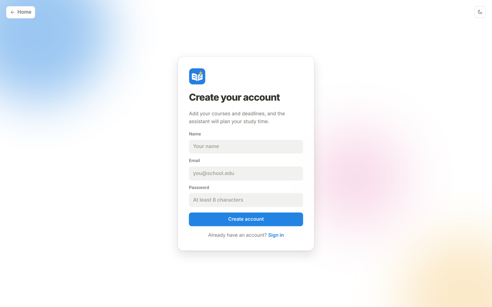
</p>

The welcome page also shows Ask AI and Notes in action with short animations:

<p align="center">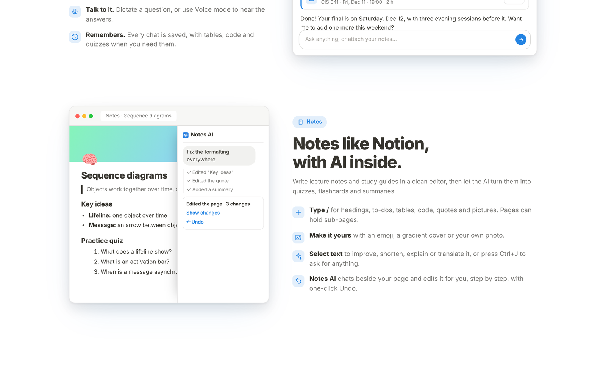</p>

Forgot your password? On the sign-in page, click **Forgot password?**, type your email, and open the link in the email you receive to choose a new password.

### 2. Add your courses

Go to **Courses**. Fill in the **Course code** (for example `CIS 641`), the **Course name**, your **Weekly study goal (hrs)** (optional: clear it with × for no goal) and a **Color**, then click **Add course**. Each course card shows its open tasks, the hours you studied this week, its weekly goal and its materials. Click **Edit course** on a card to change its code, name, goal or color.

<p align="center"></p>

### 3. Add your assignments and exams

Go to **Assignments & Exams**. Give each task a **Title**, pick the **Course** and **Type** (Assignment, Exam, Quiz, Project or Reading), set the **Due date**, the **Priority** and the **Study hours needed**, then click **Add**. Tick the box when a task is done. Use the filters to see one course or finished work.

<p align="center">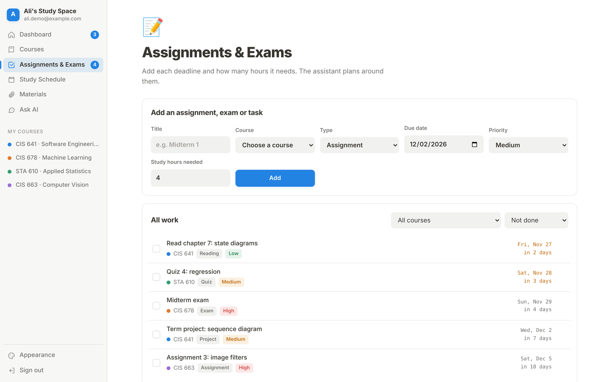</p>

> **Tip:** "Study hours needed" is what the assistant plans around, so give an honest estimate.

### 4. Follow the plan on the Dashboard

The **Dashboard** shows:

- **What to study next**: the tasks where you are furthest behind, with a suggested plan of study sessions before the deadline. Click **Accept and add to schedule** to put those sessions in your calendar, or **Dismiss** to hide the advice.
- **Study progress**: hours studied in the last 7 days compared with each course's weekly goal.
- **Today's sessions**: tick them off when you finish.
- **Log study time**: record studying you did outside a planned session.

See the screenshot at the top of this page.

### 5. Plan your week

Go to **Study Schedule**. Add a session with a **Course**, **Date**, **Start** time, **Hours** and a **Focus**, then click **Add session**. The week view shows your sessions, and deadlines appear as red boxes. Tick a session when you finish it, and its hours count toward your progress. Use **Previous**, **This week** and **Next** to move between weeks.

<p align="center">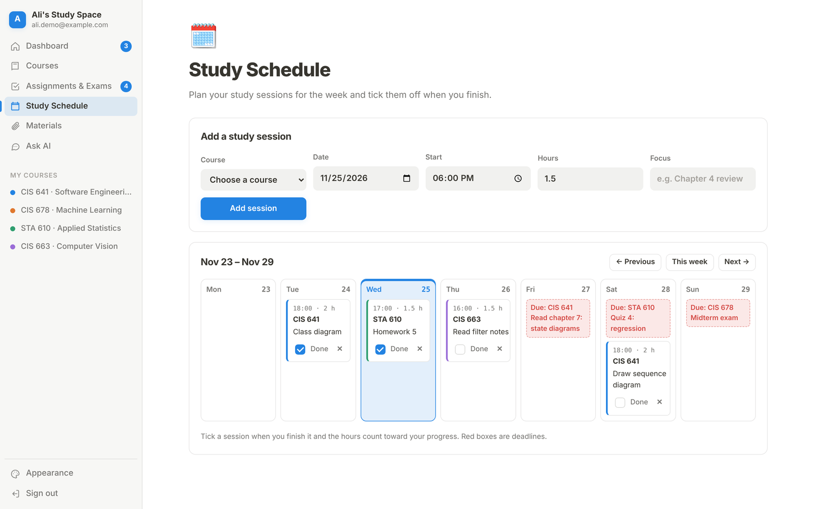</p>

### 6. Keep your materials together

Go to **Materials**. Choose a course under **Add to a course**, then drop files into **Upload files** or save a web address with **Add a link**. Click a file to download it.

<p align="center"></p>

### 7. Write your notes

Go to **Notes** and pick a template (Lecture notes, Study guide, Assignment plan) or start from an empty page. Your pages are listed on the left, the page is in the middle, and **Ask AI** opens the AI panel on the right. Everything saves by itself while you type.

<p align="center">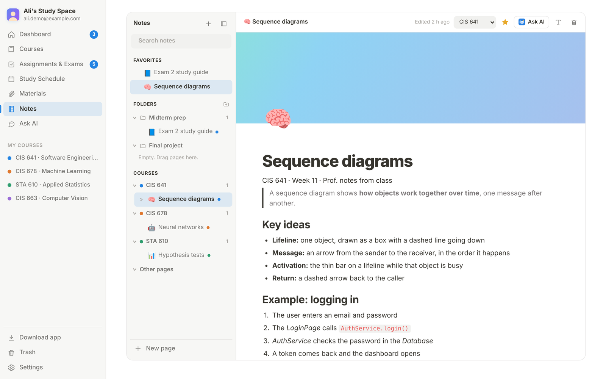</p>

- Type **/** to add a heading, a list, a to-do, a toggle, a quote, a table, code, a divider or a picture. Markdown shortcuts work too: `# ` for a heading, `- ` for a list, `[] ` for a to-do.
- Hover the title to **Add icon** or **Add cover**. A cover can be one of 12 gradients or **your own picture** from your computer or phone (you can also drop a picture on the cover). Use **Reposition** to choose which part of the picture shows.
- Click **+** next to a page in the list, or **Add a sub-page** at the bottom, to put pages inside pages.
- Use the ⭐ to add a page to **Favorites**, the course menu to tag it with a course, and **Search notes** to find any word.

**Organize your pages.** The list on the left groups your pages **by course** (from each page's course tag). Make your own **folders** with the folder button next to *Folders*, then drag a page onto a folder, or hover a page and click its folder icon. Click a group to open or close it. Drag the edge of the list to make it wider. The **T** button at the top of a page sets its **text size** and **full width**.

<p align="center">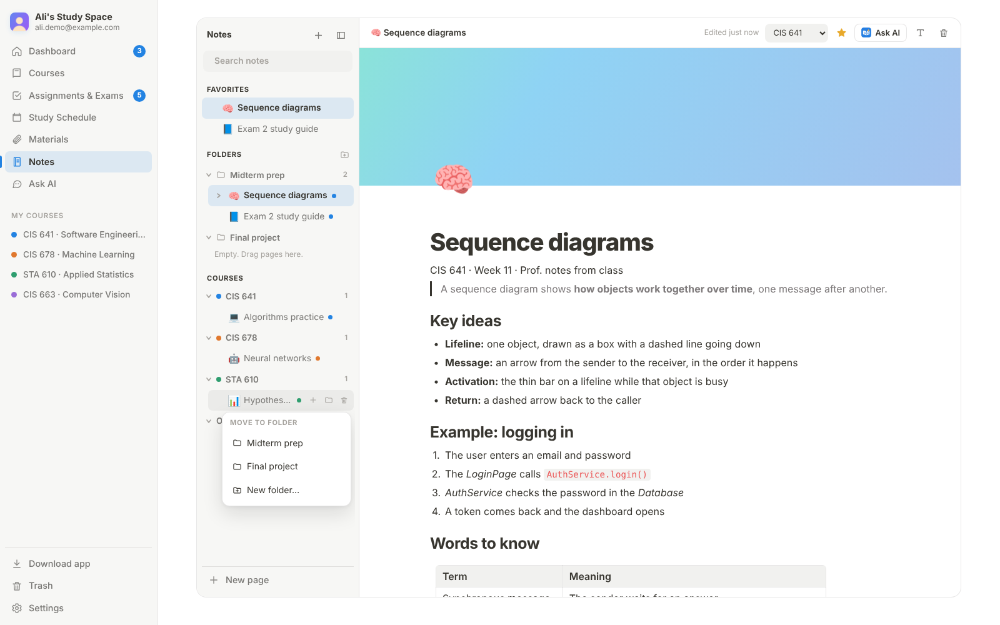</p>

<p align="center">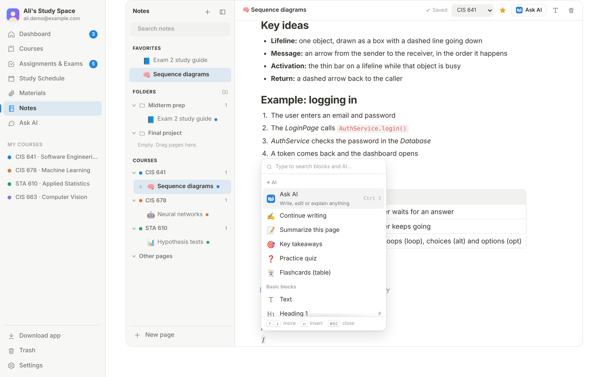</p>

**AI inside your notes.** Select some text and click **Ask AI** in the toolbar (or press **Ctrl+J**, or type **/ai**). Choose **Improve writing**, **Fix spelling & grammar**, **Make shorter**, **Explain this**, **Translate**, **Turn into a table** and more, or type your own request. The answer appears as a preview first; then click **Replace selection**, **Insert below**, **Try again** or **Discard**, or type a follow-up such as *"make it simpler"*. Press **Ctrl+Z** to undo an insert.

<p align="center">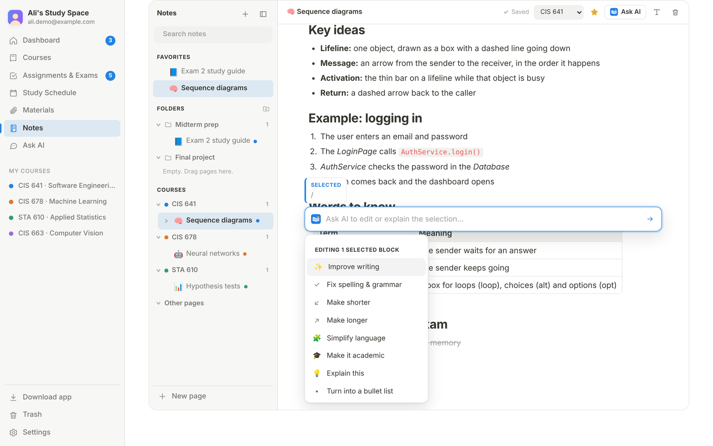</p>

**Chat with the AI next to your page.** Click **Ask AI** at the top of a note to open the **Notes AI** panel. It reads the page (the page chip in the message box; click it to leave the page out), and you can attach files or pictures with **+** or by dropping them on the panel. Ask a question, or ask it to change the page, for example *"Fix the spelling and formatting everywhere"* or *"Add a practice quiz at the end"*. The changes appear in the page right away and are highlighted; click **N steps** to see each one, **Show changes** to see before and after, and **Undo** to put the page back. Under each answer: **Copy**, **+** (add the answer to the page), 👍 / 👎 and **Undo**.

<p align="center">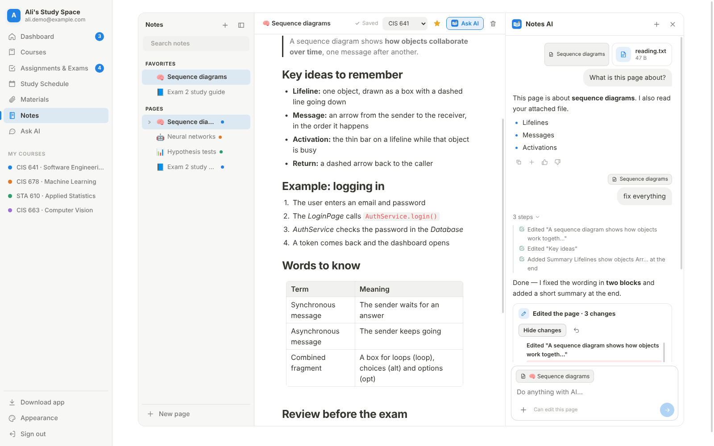</p>

Drag the left edge of the Notes AI panel to make it wider or narrower.

**Write and run code.** Type ```` ``` ```` or choose *Code* in the **/** menu, then pick the language at the top of the block. Code is colored as you type (choose a color theme with the 🎨 button) and works like VS Code: `Tab` / `Shift+Tab` indent, `Ctrl+/` comments, `Alt+↑/↓` moves lines, and grey **AI suggestions** appear as you type (`Tab` accepts). For **Python, JavaScript, SQL and HTML**, click **▷ Run** (or press `Ctrl+Enter`): the output appears in a block right under the code, and HTML opens in a preview window. Code runs in your own browser, so it is private and free, and a run is stopped after 10 to 20 seconds in case of an endless loop. The first Python run downloads Python once (about 10 MB).

<p align="center">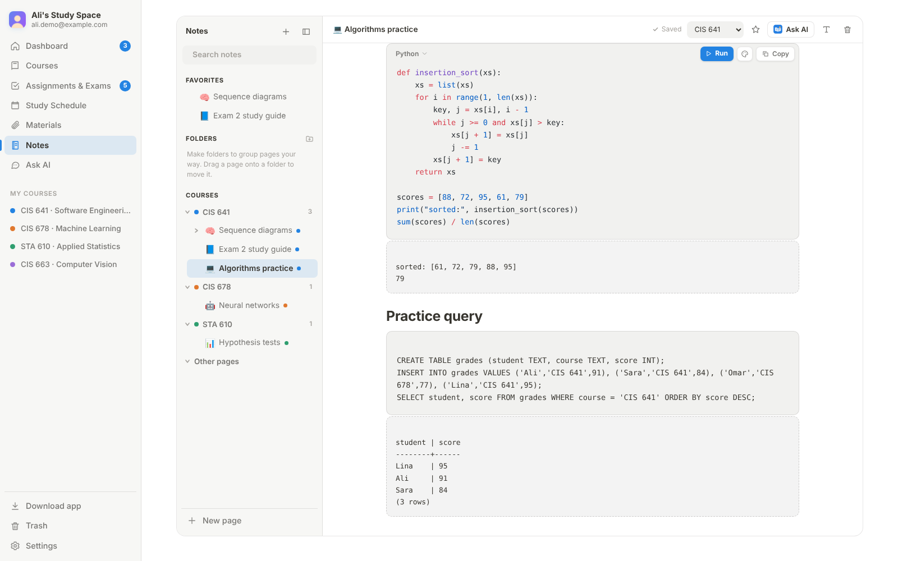</p>

### 8. Ask the AI

Go to **Ask AI**. Ask anything about your studies, or click one of the suggestions.

<p align="center"></p>

**Let it do the work.** Tell it what to add, for example:

> Add my CIS 641 final exam on December 12 and plan three 2-hour study sessions before it.

Each change appears as a card. Click **View** to open the page, or **Undo** to take the change back. The AI can add courses, assignments, exams and study sessions, log study time, change or finish tasks, and write notes. It cannot delete anything.

It also knows your notes. Try *"What did I write about lifelines?"*, *"Quiz me on my Sequence diagrams note"* or *"Save a study guide for exam 2 as a note"*.

<p align="center">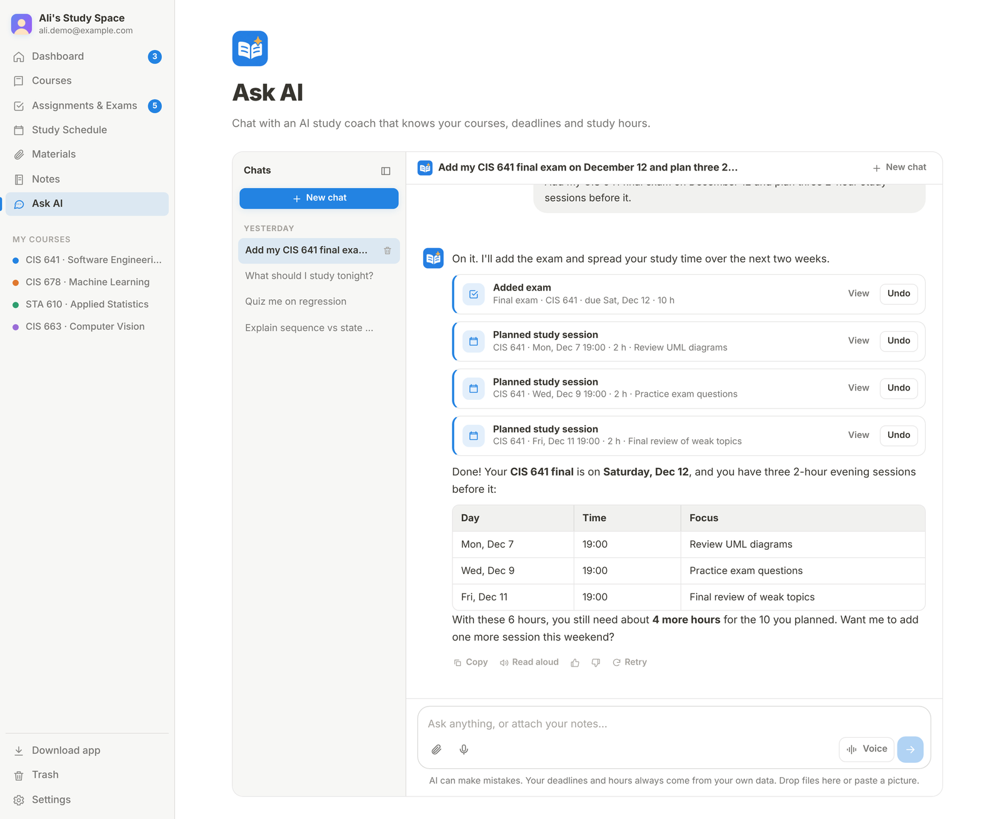</p>

More things you can do in the chat:

| Button | What it does |
|---|---|
| 📎 **Attach** (or drag and drop, or paste with Ctrl+V) | Add a PDF, notes, code or a picture to your question, for example *"Add all the exams from this syllabus"* |
| 🎤 **Dictate** | Speak instead of typing (Chrome and Edge) |
| **Voice** | A hands-free conversation: you talk, the assistant answers out loud, then listens again |
| **Copy**, **Read aloud**, **Retry** | Under each answer |
| ✏️ **Edit**, ↻ **Send again** | On your own messages |
| ■ **Stop** | Stops an answer that is being written |
| **Chats** panel | Every conversation is saved. Click one to go back to it, or the 🗑 icon to delete it. **New chat** starts a fresh one |

### 9. Get reminders

Open **Settings › Notifications › Open reminder settings** and turn on what you want:

- **Morning summary:** your top priorities, what is due today and tomorrow, and today's study sessions, at the hour you choose.
- **Deadline alerts:** the morning before something is due, and on the day itself.
- **Study session alerts:** 15 to 30 minutes before a planned session.
- **Weekly progress:** Sunday evening, hours studied against each course's goal and the week ahead.

Choose where they go: **Email**, and **Notifications on this device** (click **Turn on** on each phone or computer you use; on iPhone, add the app to the Home Screen first). **Send me a test** shows you what they look like. Every email has a one-click link to turn reminder emails off.

<p align="center">
  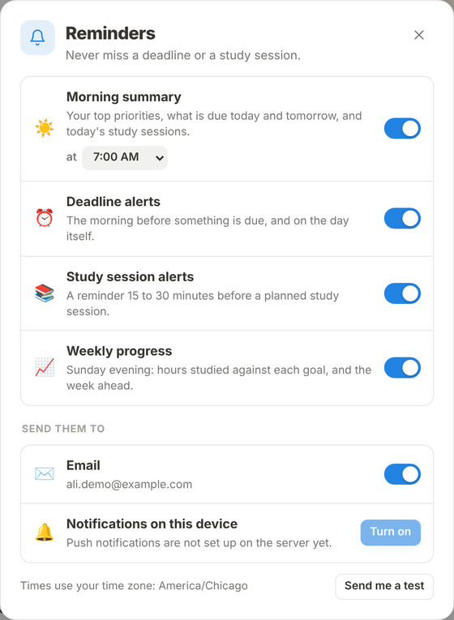
  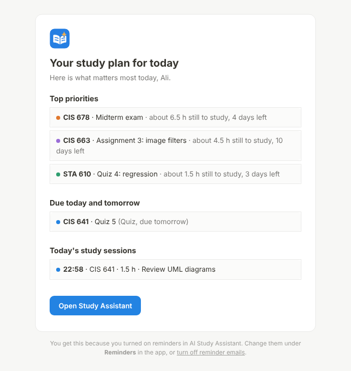
</p>

### 10. Settings and your look

Click **Settings** at the bottom of the sidebar (or press `Ctrl+,`). **Account** has your profile picture (click it to upload one), name, email, password, *sign out of other devices* and *delete account*. **Appearance** has the theme (System, Light, Dark, Paper or Midnight), accent color, font, text size, code colors and *reduce motion*. **Language & region**, **Notifications**, **Data & privacy** (export everything) and **About** (all keyboard shortcuts) are there too.

<p align="center">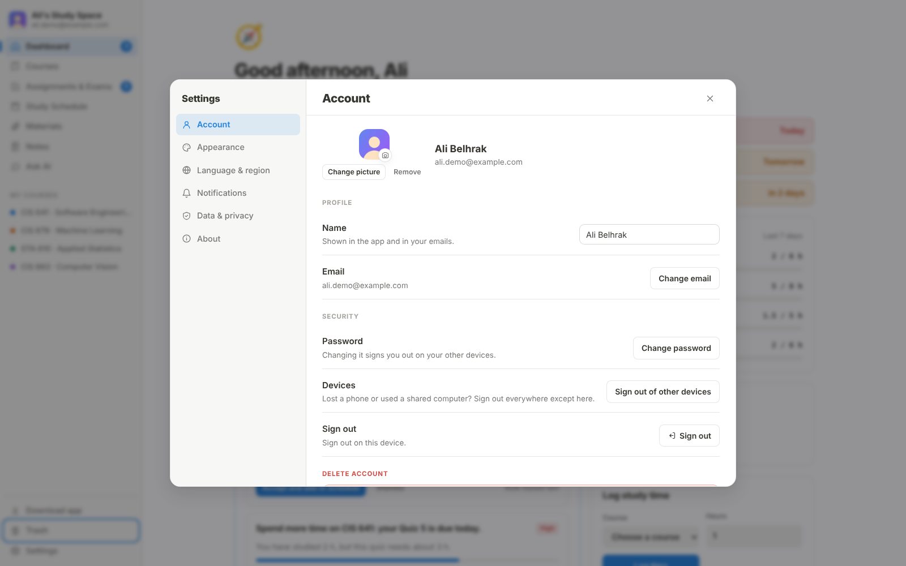</p>

<p align="center"></p>

### 11. Choose your language

Pick a language with the 🌐 button on the welcome page or the sign-in page, or in **Settings › Language & region**. The menus, buttons, dates and messages change at once, Arabic switches the layout to right to left, and the note editor's menus follow too. The AI then answers in your language (unless you write to it in another one), the study advice is written in it, and reminder and password emails arrive in it. Your notes and course names stay exactly as you wrote them.

<p align="center">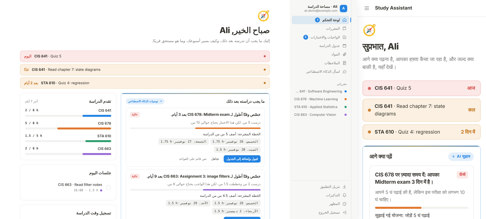</p>

### 12. Download the app to your laptop or phone

Click **Download app** at the top of the welcome page, or in the sidebar once you are signed in.

- **Chrome or Edge** (Windows, Mac, Chromebook, Android): the browser's **Install** window opens. Click **Install** and the app gets its own window and an icon in the Start menu, taskbar or Dock.
- **Other browsers:** a short guide shows the steps for your browser:
  - **iPhone (Safari):** tap **Share**, then **Add to Home Screen**.
  - **Mac (Safari):** click **File**, then **Add to Dock**.
  - **Firefox:** open the site in Chrome or Edge instead.

<p align="center">
  
</p>

The installed app fills the whole screen on phones, follows your theme, and updates by itself every time a new version is deployed.

<p align="center">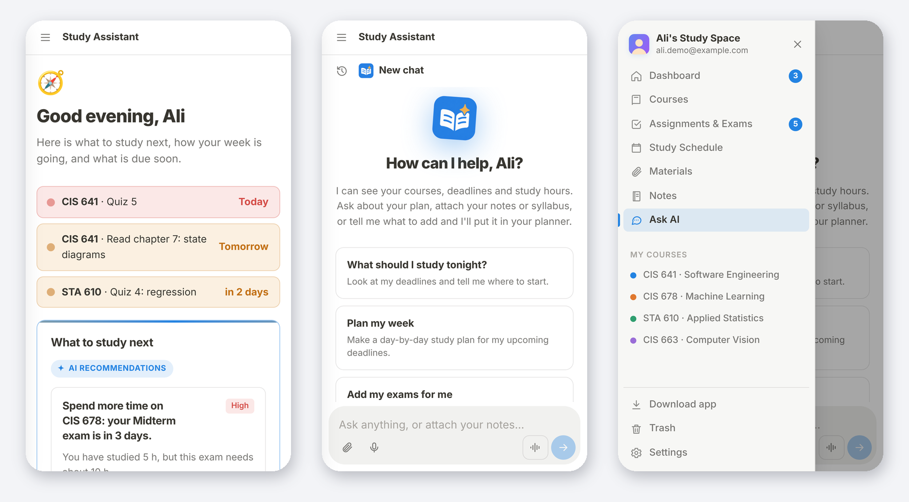</p>

**App stores:** the Windows app passed **Microsoft Store** certification in November 2026 ([Store page](https://apps.microsoft.com/detail/9PJZX6KSS8TH)). An Android (Google Play) package has been built too. Both are made with [PWABuilder](https://www.pwabuilder.com) from this same web app, so they update whenever the website does. An iPhone App Store version needs a Mac to build.

### 13. Undo a mistake with the Trash

Deleting never loses your work right away. When you delete a course, task, study session, file, page or chat, a message says **Moved to Trash** with an **Undo** button. Later, click **Trash** at the bottom of the sidebar to search what you deleted and **Restore** it, or **Delete for good**. A deleted course comes back with its tasks, sessions and files. Things in the Trash are deleted for good after 30 days.

<p align="center">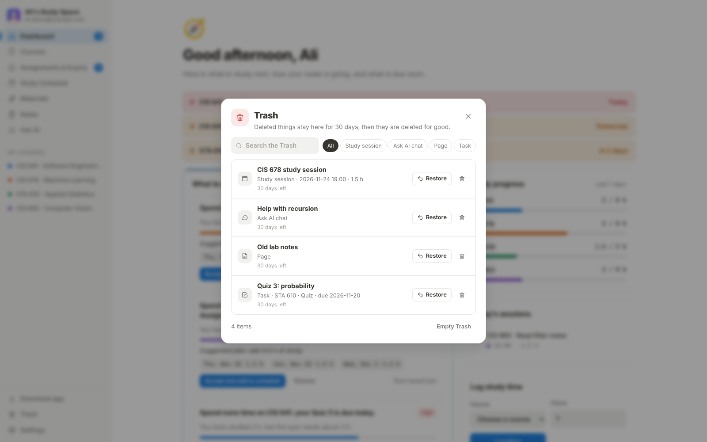</p>

## How the AI works

The AI recommendations are designed so that the language model **can never invent hours or dates**:

1. **Rules find the study gap** for every open task due in the next 14 days:
   `gap = hours needed − hours studied − hours planned`
2. **Rules rank the tasks and build the plan:** score = gap × priority × task type × urgency. The top three get a plan of study sessions of up to 2 hours each, placed before the deadline.
3. **A language model writes the message** from those numbers only. If the model is off, slow or gives an invalid answer, the app uses rule-based text instead.
4. **The student decides:** accepting adds the sessions to the schedule; dismissing hides the advice.

The **Ask AI** chat sends the model a short summary of the student's own data (courses, open tasks, the computed study gaps and planned sessions) with each question, plus a guide to the app's pages. When the student asks it to add or change something, the model asks the server to run a **tool** (add a course, add a task, plan a session, log time, update a task, write a note or add to one, search or read a note). The server checks every value, finds the course or task by name, saves the change for that student only, and returns the result to the model. Nothing can be deleted this way, and every change can be undone.

**AI in the notes** sends the page (as Markdown), the selected text and the chosen action to the server, which asks the model for Markdown only and streams it back. The editor shows it as a preview and turns it into real blocks only when the student clicks Insert or Replace.

The **Notes AI panel** sends the page as a list of blocks, each with its id, plus the conversation and any attached files. The model answers, or changes the page with four tools: edit a block, insert blocks, delete a block, or rewrite the page. The server checks every change (the block must exist on that page) and streams it to the browser, which applies it to the editor right away, highlights it, and keeps a copy of the page from before the answer so **Undo** restores it exactly. Thumbs up / down are saved so the team can see which answers help.

Any OpenAI-compatible model works: [Groq](https://console.groq.com) (free, used online), OpenAI, or a local model through [Ollama](https://ollama.com). Without a model, the app still works and uses rule-based text; only the chat is turned off.

## Tech stack

| Part | Technology |
|---|---|
| Front end | React 18, Vite, React Router, plain CSS, PDF.js for reading attached PDFs, [BlockNote](https://www.blocknotejs.org) (with Mantine) for the Notion-style notes editor, Shiki for code colors |
| Running code | [Pyodide](https://pyodide.org) (Python in WebAssembly), [sql.js](https://sql.js.org) (SQLite), web workers and a sandboxed iframe, all in the browser |
| Back end | Node.js 22, Express 5, JSON Web Token login, bcrypt password hashing, Multer file uploads |
| Database | MongoDB (MongoDB Atlas online), Mongoose |
| AI | Any OpenAI-compatible chat API with tool calling (Groq online); a vision model for pictures |
| Voice | The browser's Web Speech API (speech to text and text to speech) |
| Email and notifications | Brevo email API (password reset and reminder emails), Web Push with VAPID keys (`web-push`), a GitHub Actions schedule that wakes the server every 15 minutes |
| Hosting | Render (one web service serves the API and the built React app) |
| Phone and desktop app | Installable web app (web app manifest, service worker, one-click install button); Android and Windows store packages made with PWABuilder |
| Local deployment | Docker Compose (MongoDB, API, and nginx serving the app) |

## Team Members and Roles

* [Ali Belhrak](https://github.com/alibelhrak/CIS641-HW2-Belhrak) (Project Manager, Analyst, Designer, Developer)

## Prerequisites

* [Git](https://git-scm.com/)
* **Either** [Docker Desktop](https://www.docker.com/products/docker-desktop/) (simplest: runs everything with one command)
* **Or** [Node.js 22](https://nodejs.org/) and a MongoDB database (a free [MongoDB Atlas](https://www.mongodb.com/atlas) cluster or a local MongoDB)
* Optional: a free [Groq](https://console.groq.com) API key (or [Ollama](https://ollama.com)) for the AI text and the chat
* Optional: a free [Brevo](https://www.brevo.com) account to send password reset emails

## Run Instructions

### Option 1: Docker (one command)

```
git clone https://github.com/alibelhrak/GVSU-CIS641-AIStudyAssistant.git
cd GVSU-CIS641-AIStudyAssistant/src
copy .env.example .env        (macOS/Linux: cp .env.example .env)
docker compose up -d --build
```

Open http://localhost:8080, create an account, add a course, then add an exam with the study hours it needs. The Dashboard shows the recommendation.

### Option 2: Node.js (for development)

1. Create `src/server/.env` with at least:
   ```
   MONGO_URI=your MongoDB connection string
   JWT_SECRET=any long random text
   ```
   To turn on Ask AI, also add:
   ```
   LLM_BASE_URL=https://api.groq.com/openai/v1
   LLM_API_KEY=your Groq key
   LLM_MODEL=llama-3.3-70b-versatile
   CHAT_MODEL=openai/gpt-oss-120b
   VISION_MODEL=qwen/qwen3.8-27b
   ```
2. Start the API (port 5000):
   ```
   cd src/server
   npm install
   npm run dev
   ```
3. In a second terminal, start the web app (port 5173):
   ```
   cd src/client
   npm install
   npm run dev
   ```
4. Open http://localhost:5173.

All settings (AI, email and others) are listed in the [developer guide](src/README.md#settings).

### Run the tests

```
cd src/server
npm test
```

## Project Documents and Artifacts

* [Project Proposal](docs/proposal-template.md) ([PDF version](docs/project_proposal.pdf))
* [Software Requirements Specification](docs/software_requirements_specification.md)
* [Midterm Presentation](docs/AI_Study_Assistant_Midterm.pptx)
* [UML Class Diagram](artifacts/class_diagram.md)
* [CRC Cards](artifacts/crc_cards.md)
* [Sequence Diagram](artifacts/sequence_diagram.md)
* [State Machine Diagram](artifacts/state_machine_diagram.md)
* [Developer Guide](src/README.md): settings, API routes, deployment and project structure
